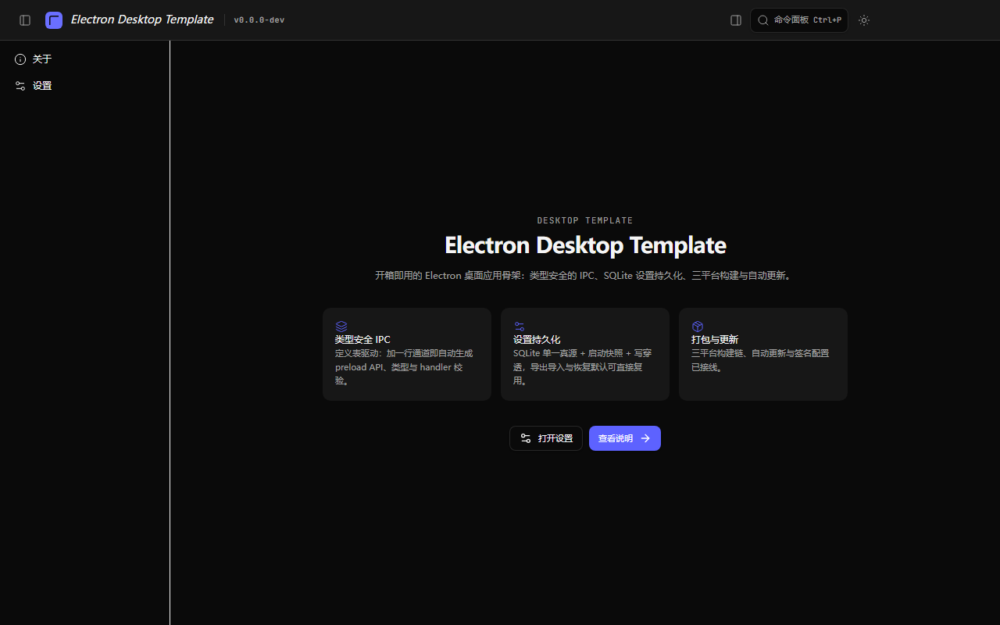

# Electron 桌面端模板

Electron 44 + React 19 + TypeScript + Vite 8 的工程级桌面应用模板（Windows / macOS / Linux）。
底座能力开箱可用，业务页面待接入。



## 成熟度与边界

**已经验证的**：类型检查、lint、19 项静态审计、单测/集成/E2E、覆盖率范围与关键模块阈值、Windows 视觉基线、生产启动 <10s，全部在本仓库本地实测通过。

**还需要发布方完成的**：
- **签名与自动更新**：当前发布口径为**三平台未签名包**；macOS 需手动绕过 Gatekeeper，未签名自动更新未验证。面向普通用户正式分发前，再完成签名/公证与「安装 → 更新 → 卸载」演练。
- **可观测性后端**：SLO、指标与 Collector 配置已定义；生产 Collector/告警后端不包含在模板内。
- **性能画像**：有 bundle 预算、启动耗时与启动趋势；没有 FCP/LCP/INP 硬门槛。
- **依赖基线**：Node 26 LTS、TypeScript 7、Vite 8 属前沿栈；升级与 override 规则见 [dependency-policy.md](docs/guides/dependency-policy.md)。
- **内部包作用域**：`@code-agent/*` 是模板内部 workspace 包名，`init:template` 不会重写；它不出现在用户可见品牌位点中。

## 包含什么

- **类型安全的 IPC 契约体系**：定义表驱动，新增一个方法只改三处，preload API / 通道常量 / 类型全部自动生成，handler 缺失在编译期报错
- **SQLite 设置持久化**：drizzle ORM + 迁移链 + 启动备份与损坏自愈；渲染层写穿透 + 启动快照
- **四层状态架构**：useState / Zustand / TanStack Query / IPC 事件流，判定标准明确
- **三平台打包与自动更新**：electron-builder + electron-updater，CI/CD 与发版流程已接线
- **凭据存储**：safeStorage 加密落盘（DPAPI / Keychain / libsecret），渲染层只见掩码
- **质量门禁**：类型、lint、19 项静态审计、单测、集成测试、E2E、视觉回归、覆盖率范围/关键模块阈值、死代码检测、密钥扫描
- **品牌单一真源**：`app.config.json` 一处改产品名 / appId / 协议 / 存储前缀

## 快速开始

```bash
pnpm install
pnpm dev          # Electron 窗口
pnpm dev:web      # 浏览器模式（mock api）
pnpm test:coverage # 覆盖率 + 范围/关键模块/设置层硬门槛
pnpm test:visual   # Windows 视觉基线（需先安装 Playwright Chromium）
```

> 首次安装会下载 Electron 二进制（约 100+ MB），需要网络；安装钩子失败会明确报错，不会留下「能装不能跑」的状态。

## 从模板开始你的项目

一条命令改完全部品牌位点（真源 + package.json + 构建配置 + LICENSE + CODEOWNERS + 文档 URL + i18n 文案 + CHANGELOG）：

```bash
pnpm init:template --name "My App" --app-id com.me.myapp --protocol myapp \
  --owner me --repo myapp --author "Me" --dry-run   # 先看会改哪些文件
pnpm init:template --name "My App" --app-id com.me.myapp --protocol myapp \
  --owner me --repo myapp --author "Me"             # 实际执行
pnpm check:brand                                    # 校验全部位点对齐
```

命令幂等：重复执行同一组参数不会产生额外改动。产品名含中文等非 ASCII 字符时，可执行名无法自动推导，需显式指定：

```bash
pnpm init:template --name "演示应用" --executable demo-app \
  --app-id com.demo.app --protocol demoapp --owner demo --repo demo
```

之后：
1. 替换 `src/renderer/routes/home.tsx` 为你的首屏
2. 按需接入业务：新增 IPC 域、数据表、设置分区、页面，方法见 AGENTS.md「扩展点速查」

只改个别字段也可以手改 `app.config.json` → `pnpm brand:sync` → `pnpm check:brand`。

模板底座改动后的验收流程见 [docs/guides/template-acceptance.md](docs/guides/template-acceptance.md)；从上游模板同步变更见 [docs/guides/updating-from-template.md](docs/guides/updating-from-template.md)。

### 覆盖率口径

`coverage.include` 已显式纳入三层源码；排除项包括入口文件（`main/index.ts`、`renderer/main.tsx`/`App.tsx`）、由 E2E 覆盖的应用壳/路由装配，以及 `providers/**`、`lib/query/**`、`SettingsDialog`/设置分区注册表这类页面级装配（由浏览器/Electron E2E 兜底）。`check:coverage-scope` 防止新源码再次隐身，`check:critical-coverage` 对 db/CSP/IPC/更新/凭据等高风险模块按文件卡关，settings 子集由 `coverage:settings --check` 硬卡。

## 目录

```
src/main/       主进程（组合根 + 服务容器 + IPC handler）
src/preload/    桥接（CJS / sandbox）
src/renderer/   React 渲染层
packages/shared IPC 契约 / zod schema / 常量
docs/           文档：design 规范 / guides 操作 / history 实施记录
```

完整说明见 [AGENTS.md](AGENTS.md)（面向 AI 协作者与新人）与 [docs/README.md](docs/README.md)（文档导航）。

## 许可证

Apache License 2.0（见 [LICENSE](LICENSE)）
