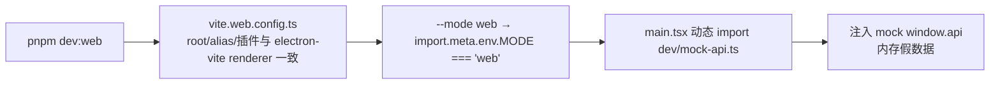
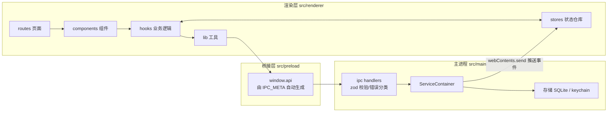
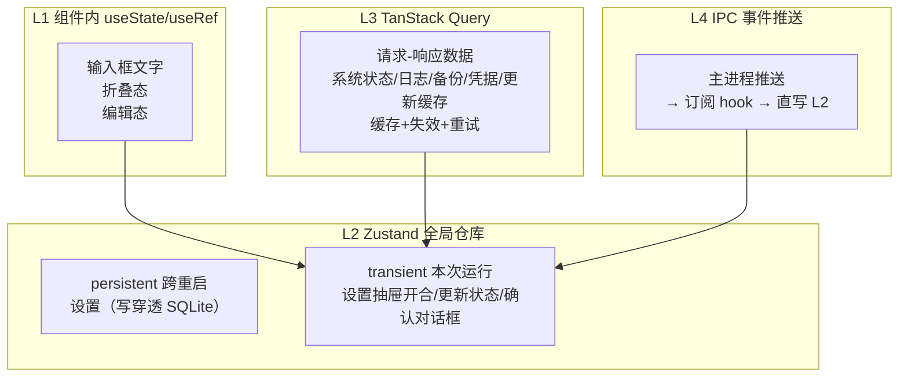
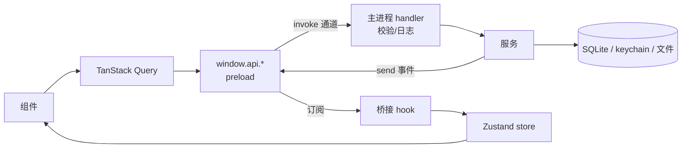
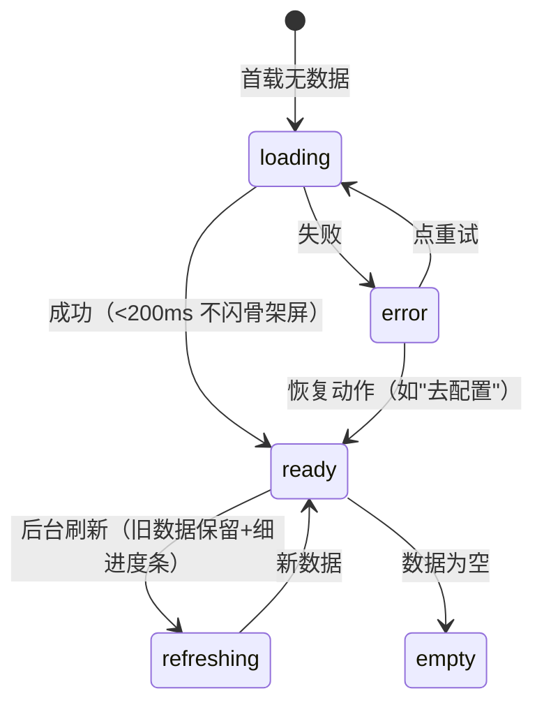
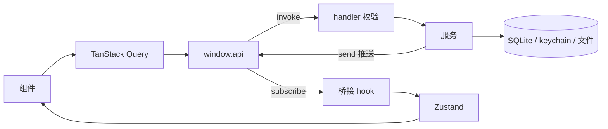

# 前端开发实现指南（09）

> 给开发人员看的实现指南：架构 → 设计体系 → 布局 → 组件 → 交互 → 数据流。
> 所有内容对应实际代码；模板未实现的能力明确标注「未提供」。
> 整理时间：2026-10-22（模板版：随业务剥离重写，并按当前组件/分区数量订正）

## 0. 这是什么

一份"照着就能把界面做出来"的说明书。与 [19-ipc-spec.md](19-ipc-spec.md)（契约怎么加）互补：本文讲**渲染层怎么组织**。阅读顺序：架构图 → 设计体系 → 布局 → 原子组件 → 业务组件 → 数据流。

## 0.1 前端独立开发模式（pnpm dev:web）

渲染层可以不依赖 Electron 主进程，在浏览器里单独开发、调试全部界面：

```bash
pnpm dev:web   # vite --config vite.web.config.ts --mode web
```

工作原理：



- **mock 覆盖**：模板保留的全部域（app / window / dialog / settings / system / logs / devtools / backup / update / proxy / secrets / invalidation）；新增业务域时同步补 `src/renderer/dev/mock-api.ts`
- **隔离性**：仅 `--mode web` 注入；`pnpm dev`（Electron）由 preload 注入真实 `window.api`；生产构建与 E2E 不加载 mock 代码（动态 import + 条件短路）
- **相关文件**：`vite.web.config.ts` / `src/renderer/dev/mock-api.ts`（`createMockApi` 通过 `satisfies IpcApi` 对齐类型，`mock-api.test.ts` 按 `IPC_META` 校验域/方法/kind）/ `src/renderer/main.tsx` / `package.json` 的 `dev:web`
- **已知限制**：mock 是内存态，刷新即失；不模拟 IPC 失败分支（错误态需在真实主进程或单测中验证）

## 一、全局架构

### 1.1 系统分层



### 1.2 状态四层（L1-L4）



判断标准一句话：**IPC 问一次拿结果 → L3；IPC 持续推送 → L4 写 L2；界面交互态 → L2；组件独享 → L1。**

### 1.3 数据怎么跨进程



- 通道命名：`域:动作`（请求）、`域:stream:事件`（流式）、`域:event:名称`（状态事件）；全表见 [19-ipc-spec.md](19-ipc-spec.md)
- 错误约定：返回 `{ data } | { error: { code, message } }`，渲染层统一 `unwrap()`（`lib/ipc.ts`）按 code 查 i18n

## 二、UI 设计体系（Template）

唯一真源：`src/renderer/styles/tokens.css`（CSS 变量）+ `styles/index.css`（`@import` 各域 + `@theme`）。原则：**所有颜色/尺寸走 CSS 变量（令牌），禁止硬编码**。

- 令牌由 Style Dictionary 从 `tokens/aurora.json` 生成，`pnpm tokens:check` 校验生成物与真源一致
- 门禁：`check:tokens`（裸色 / hex / 双写）、`check:css-vars`（`var(--x)` 必须有定义）、`check:animations`（`animation` 引用的 keyframes 必须存在）
- 样式文件分区：`tokens` / `base` / `layout` / `palette`（命令面板）/ `motion`；业务样式接入时新建文件并在 `index.css` 登记，不沿用上游类名
- 动效统一走 `lib/motion/`（transitions / variants 集中定义），不散写 CSS transition

## 三、页面布局

### 3.1 整体框架 AppShell

```
┌──────────────────────── topbar 52px 玻璃顶栏 ────────────────────────┐
├──────────┬──┬────────────────────────────┬──┬──────────────────────┤
│ sidebar  │R │         main               │R │    right-panel       │
│ 200-400px│6 │   欢迎页 / 关于页           │6 │    260-360px         │
│          │px│                            │px│   （可折叠）          │
└──────────┴──┴────────────────────────────┴──┴──────────────────────┘
```

- 栅格：`.app` 两行（52px + 1fr）；列宽来自 CSS 变量
- 宽度动态：拖拽后 JS 写变量覆盖（钳位见 `layout-utils.ts` 的 `SIDEBAR_WIDTH_MIN/MAX`、`RIGHT_PANEL_WIDTH_MIN/MAX`）
- 折叠：class 切换 → 变量置 0 → 列塌缩；断点 `<1200px` 折右面板、`<900px` 折侧栏（`useLayoutBreakpoint`，手动操作过不覆盖）
- 关键坑：`.main-surface` 必须占固定列——折叠元素 `display:none` 不占轨道，否则双折叠时 main 宽度塌成 0

### 3.2 欢迎页 `/`（`routes/home.tsx`）

模板首屏，也是「新增页面」的最小样板：三张能力卡片 + 「打开设置」动作。

### 3.3 设置全屏页（`components/settings/SettingsDialog.tsx`）

```
┌ [← 返回]  ⚙ 设置                        （140px 拖拽避让区）┐
├──────────┬───────────────────────────────────────────┤
│ 通用     │  内容区（滚动，每分区独立错误边界）      │
│  常规     │                                          │
│  外观     │                                          │
│  通知     │                                          │
│ 高级     │                                          │
│  数据     │                                          │
│  凭据     │                                          │
│  代理     │                                          │
│  快捷键   │                                          │
│ 关于     │                                          │
├──────────┴───────────────────────────────────────────┤
│ 导航：160px 固定列；激活项 = accent 2px 竖条 + 加粗    │
└──────────────────────────────────────────────────────┘
```

分区由注册表驱动（`sections/registry.tsx`）：新增分区 = `sections/<name>-section.tsx` + `lib/settings-sections.ts` 加 id + 注册表加一行。

## 四、原子组件库（`components/ui` 15 个）

alert-dialog / button / card / dialog / dropdown-menu / input / label / progress / select / sheet / sonner / spinner / switch / toggle-group / tooltip

共同约定：

- 基于 Radix 原语 + cva 变体 + Tailwind 类；不自研可访问性基础件
- **禁止裸 `<button>`**（`check:ui-consistency` 的 `raw-button` 规则）：一律用 `Button`，图标按钮 `size="icon"`
- 条件 className 一律走 `cn()`
- 单实例多入口的对话框状态收敛到 `ui-store`（先例：settingsOpen / paletteOpen / shortcutHelpOpen）

## 五、业务组件

### 5.1 全局异步五态（AsyncBoundary）



所有列表/面板统一用 `AsyncBoundary`（`components/common/AsyncBoundary.tsx`）+ `useAsyncView`，不手写 loading/error 分支。

### 5.2 应用外壳

| 组件 | 职责 |
|---|---|
| `AppShell` | 布局骨架 + 全部桥接挂载（`useAppBridges()`）+ 快捷键接线 |
| `Topbar` | 品牌（`PRODUCT_NAME`）+ 侧栏/右栏折叠 + 命令面板 + 主题 + 更新指示 |
| `Sidebar` | 导航骨架，条目由 `NAV_ITEMS` 数据驱动（非硬编码 JSX） |
| `CommandPalette` | 命令面板（设置 / 关于 / 主题） |
| `UpdateIndicator` | 更新状态徽标（订阅 `update:event:status`） |

### 5.3 错误边界三层

| 层 | 组件 | 捕获范围 |
|---|---|---|
| 应用级 | `AppErrorBoundary` | 整棵 React 树崩溃 → 全屏兜底 + 报障深链 |
| 路由级 | `RootErrorBoundary`（`routes/root.tsx`） | 路由渲染/懒加载失败 |
| 分区级 | `SectionErrorBoundary` | 单个设置分区崩溃不影响其他分区 |

⚠️ 必须以 `FallbackComponent`（而非 `fallbackRender`）挂载：React Compiler 会给函数注入 memo hook，类组件 render 路径没有 hooks dispatcher，直接调用即抛「Invalid hook call」——最后一道兜底自身崩溃，用户看到白屏。

### 5.4 设置分区

| 分区 | 组件 | 消费的真源 |
|---|---|---|
| 常规 | `general-section` | 语言 / 关窗行为 / 开机自启 / 遥测（组合页；数据目录在「数据」分区） |
| 外观 | `zoom-section` | `appearance.zoom` → `window:applyZoom` |
| 通知 | `notification-section` | `notification.enabled` → 主进程 `tray.ts` 读取 |
| 数据 | `data-section` | 导出/导入设置、打开数据目录、更新缓存、数据库备份 |
| 凭据 | `secrets-section` | `secrets` 域（只见掩码） |
| 代理 | `proxy-section` | `proxy` 设置 + `proxy:test` |
| 快捷键 | `shortcuts-section` | `shortcuts` 设置 + 冲突检测 |
| 关于 | `about-section` | `app:getInfo` / `system:getStatus` / 更新状态 |

## 六、数据流

### 6.1 总链路



### 6.2 桥接层（preload）

`createIpcApi(IPC_META)` 生成全部 API → `contextBridge.exposeInMainWorld('api', api)`，零手写；`IPC_META` 走 `@code-agent/shared/ipc/meta` 子路径导入（纯字符串零 zod——`sandbox:true` 下 preload 必须 CJS，require zod 会静默失败导致 `window.api` 为 undefined）。

### 6.3 查询约定

- query 逻辑放 `hooks/` 域文件，**导出 queryKey 常量**（禁组件内联字面量，`check:ui-consistency` 的 `inline-query-key` 卡关）
- 响应一律 `unwrap()`（`lib/ipc.ts`），禁手写 `'data' in` 判别
- 变更操作用 `useMutation` 且**必须挂 onError** → `toast.error(unwrapErrorMessage(error, getErrorMessage))`
- 危险操作（删除/清空）走命令式 `confirm()`（`confirm-dialog-store`），禁内联 AlertDialog

### 6.4 缓存与失效

见 [data-ownership.md](data-ownership.md)：失效域词表 `INVALIDATION_DOMAINS` 是主进程声明侧与渲染层映射侧的共同真源。

### 6.5 桥接挂载点

`components/layout/bridges.ts` 的 `useAppBridges()` 是渲染层订阅主进程事件的唯一入口（`use-invalidation-bridge` / `use-update-bridge` / `use-settings-bridge` / `use-deep-link` / `use-protocol-check` / `use-zoom-effect`）。新增订阅在此追加一行，避免散落各处重复挂载。

## 七、完整性与文件索引

| 区域 | 文件 |
|---|---|
| 路由 | `routes/root.tsx`（布局+错误边界）/ `home.tsx` / `notes.tsx`（示例切片）/ `router.tsx` / `lib/constants.ts` |
| 布局 | `components/layout/`：AppShell / Topbar / Sidebar / bridges / layout-utils / update-indicator |
| 通用组件 | `components/common/`：AppErrorBoundary / AsyncBoundary / BrandMark / CommandPalette / DialogHost / EmptyState / MotionReveal / SectionErrorBoundary / ShortcutHelpDialog / UpdateNotice |
| 设置 | `components/settings/`：SettingsDialog / settings-controls / shortcut-picker / sections（8 个分区） |
| hooks | `hooks/`：19 个（含 use-secrets / use-backups / use-system / use-update / use-telemetry 等域 hook） |
| stores | `stores/persistent/settings-store`；`stores/transient/`：ui-store / update-store / confirm-dialog-store |
| lib | `lib/`：ipc / ipc-factories / settings-bootstrap / settings-ops / shortcut-conflicts / theme-init / motion / invalidation / query 等 |
| i18n | `i18n/`：zh-CN + en 双语，`check:i18n` 强制一致 |

## 八、未提供（相对上游完整产品）

模板未实现、接入业务时需自行补齐：会话/消息流与输入舱、文件树与文件查看器、终端、Git 面板、浏览器预览、审批卡片、模型选择器、用量与回合记录、IM 渠道、MCP 与技能管理。

样式文件现状：`palette.css` 供命令面板使用；`chat.css` 与 `loading-ui/`（终端加载光标）已随业务移除，接入时按新设计重建。
